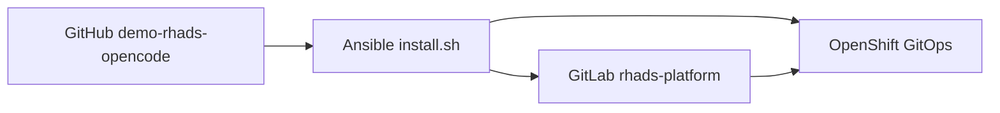
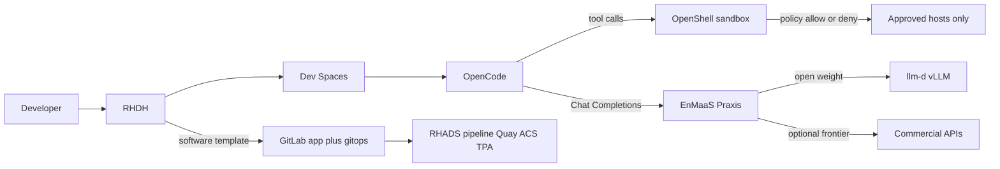

# Architecture — RHADS + OpenCode / EnMaaS / OpenShell

## Goal

A repeatable platform (Ansible + OpenShift GitOps) that demonstrates **software supply chain security** (RHADS), **governed AI coding** (OpenCode → EnMaaS → llm-d under OpenShell), and the existing **Kafka / CDC** agentic paths from [demo-rhads-kafka](https://github.com/panchoraposo/demo-rhads-kafka).

## Source of truth

| Copy | Role |
| --- | --- |
| **GitHub** `panchoraposo/demo-rhads-opencode` (`main`) | Installer and templates for the **next** cluster. |
| Local working tree | What `./install.sh` applies, then publishes to GitLab. |
| GitLab `platform-engineers/rhads-platform` | What Argo CD reconciles **after** install (placeholders substituted). |

## AI coding path

| Layer | Technology | Namespace / notes |
| --- | --- | --- |
| Portal | Red Hat Developer Hub 2.1 | `backstage` |
| IDE | OpenShift Dev Spaces | `openshift-devspaces` — OpenCode + EnMaaS env |
| Agent | OpenCode | Runs in Dev Spaces; model calls → Praxis |
| Sandbox | OpenShell + Agent Sandbox | `openshell` — Landlock / seccomp / CONNECT proxy |
| EnMaaS | Praxis AI gateway | `enmaas` — Route `enmaas.apps.<cluster>` |
| Serving | OpenShift AI + llm-d | `rhoai` / `llmd` — `LLMInferenceService` |
| Supply chain | Pipelines, Quay, ACS, TPA, RHTAS, Vault | unchanged RHADS path |

## RHADS + Kafka components (retained)

| Component | Namespace / notes |
| --- | --- |
| Streams for Apache Kafka | `kafka` — topics `flow-in` / `flow-out` |
| Kafka Console | `kafka-console` |
| Apicurio Registry | `apicurio` |
| Debezium | `debezium` — shared `KafkaConnect` |
| Cluster Observability / Perses | `rhads-observability` |

Platform routes use **short hostnames** (`<component>.apps.<cluster>`).

## Software templates (catalog)

Registered in `catalog/templates.yaml`:

1. **opencode-enmaas** — Quarkus service + Dev Spaces OpenCode wired to EnMaaS / OpenShell (primary demo).
2. **quarkus-flow-kafka** — LangChain4j trip planner + Kafka HITL.
3. **go-flow-kafka** — Go trip planner + Kafka HITL.
4. **debezium-cdc-postgres** — CDC change proposal against an existing app.

## Secrets

- **Vault plugin**: `vault.io/secrets-path: apps/{component_id}` (EnMaaS API key seeded for AI coding apps).
- **EnMaaS demo key**: `enmaas/enmaas-demo-key` for Praxis `/v1`.
